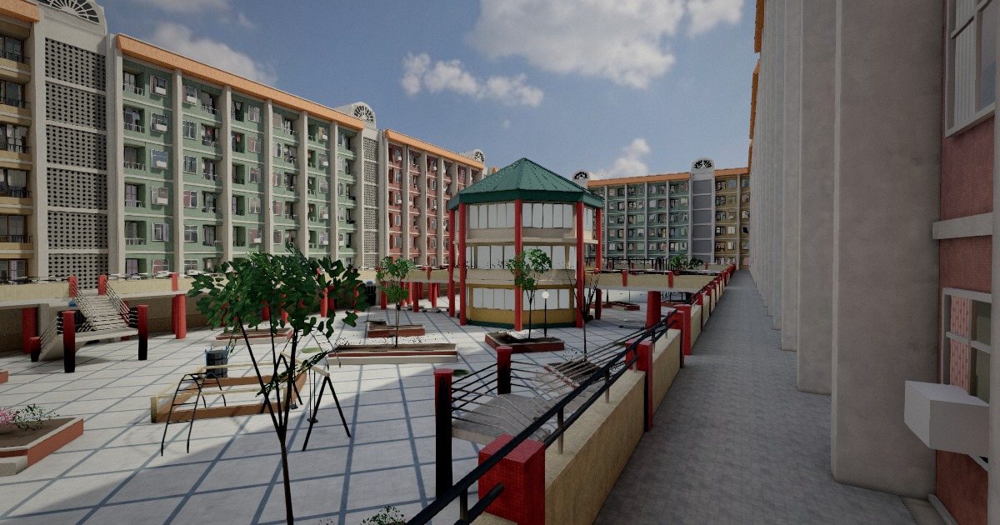
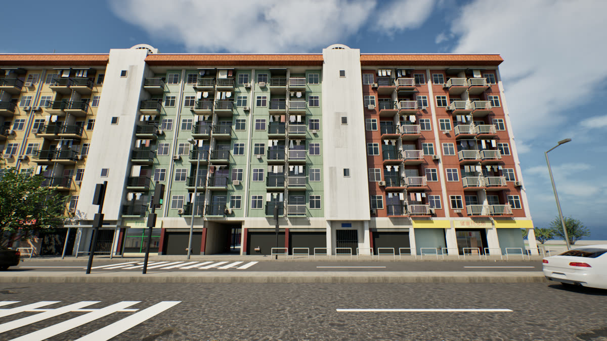
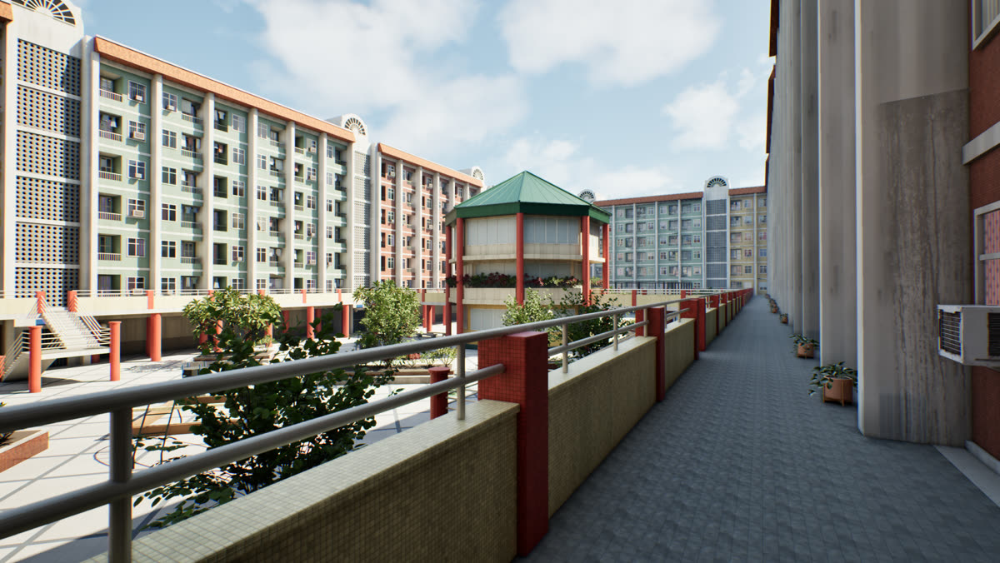
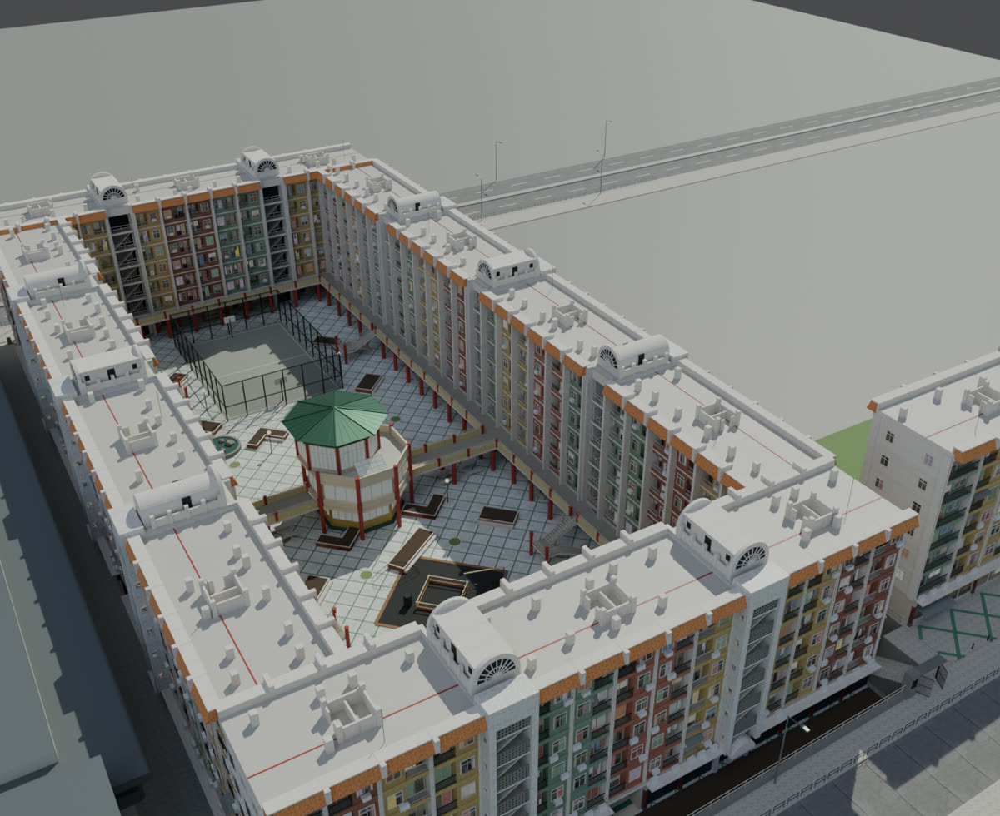

# 望廈平民新邨 2010 重建

Bairro Social de Mong-Há, Macau — a code-built reconstruction of the social housing estate as it stood around 2010, before its 2011 demolition (Blender + three.js + Unreal Engine 5.8).

用程式重建澳門望廈平民新邨在 2011 年拆卸前（約 2010 年）的樣子：Blender 腳本建模及烘焙光照，three.js 網頁版可以在瀏覽器裏走動，另有 Unreal Engine 5.8 的高畫質版本。

網頁版：<https://mongha2010site.vercel.app/>

| 網頁版（一樓走廊） | Unreal 版（慕拉士大馬路） |
|---|---|
|  |  |
| **Unreal 版（一樓走廊）** | **不烘焙預覽（1988 年俯瞰相的同一角度）** |
|  |  |

## 資料夾

| 路徑 | 內容 |
|---|---|
| `blender/build_estate.py` | 建模主程式：十四座住宅、梯塔、一樓走廊及天橋、圖書館、中庭、鐵籠球場、街道、望廈體育館、山坡兩座、馬交石石刻 |
| `blender/mh_geom.py` | 幾何工具（`test_geom.py` 是它的測試） |
| `blender/make_*.py` | 生成貼圖：紙皮石、通花磚、窗內、衣物、招牌、天空等 |
| `blender/web_bake.py`、`web_trees.py` | 網頁版的光照烘焙（Cycles）、樹木，輸出到 `web/assets` |
| `blender/preview_render.py` | 不烘焙的接近成品預覽（網頁同一套貼圖、天空和太陽） |
| `blender/compose_overlay.py`、`pair_crop.py`、`mark_points.py` | 把渲染和舊相疊加、並排對比 |
| `blender/ue_export.py` | 匯出給 Unreal 的 FBX |
| `tools/camsolve.py`、`camsolve_mh001.py`、`libfit_mh001.py` | 由舊相反推相機位置及尺寸 |
| `tools/pack_web.py`、`export_site.py` | 打包網頁版；匯出可獨立部署的網站及 ZIP |
| `tools/ue_*.py`、`ue_bridge.py` | Unreal 編輯器自動化（匯入、材質、佈景、燈光、渲染、飛行鏡頭） |
| `web/` | 網頁版：`index.html`、烘焙好的模型與光照圖（`assets/`）、貼圖（`tex/`）、Draco 解碼器 |
| `textures/` | 生成的貼圖（含天空 `sky_bake.exr`） |
| `export/` | 只保留建模需要的小檔：`markers.json`、`sky.json`、`cloth_cells.json`、相機 `cams/` |
| `MongHa2010/` | Unreal 專案檔、設定及編輯器橋接腳本（不含內容資產） |
| `FAB_清單.md` | Unreal 版用到的 Fab 免費素材清單 |

## 重建步驟

需要 Blender 5.2（以下用 `blender` 代表 `blender.exe`），以及裝有 numpy 的 Python 3。

```bash
# 1. 貼圖（只需做一次；make_photo_tex.py 和 make_sky.py 需要 cc0/ 的素材，見 cc0/README.md）
blender -b --factory-startup -P blender/make_textures.py
blender -b --factory-startup -P blender/make_web_textures.py
blender -b --factory-startup -P blender/make_atlas.py
blender -b --factory-startup -P blender/make_cloth_facade.py
blender -b --factory-startup -P blender/make_signs.py

# 2. 建模，輸出 export/MongHa_2010.blend / .glb / .fbx 及 markers.json
blender -b --factory-startup -P blender/build_estate.py -- --export

# 3. 不烘焙的預覽（視點：名稱:相機x,y,z:目標x,y,z:焦距，單位是米）
blender -b export/MongHa_2010.blend -P blender/preview_render.py -- --tag=test deck:101,5.4,106:83,6,71:24

# 4. 網頁版光照烘焙（需要 GPU，約十分鐘），然後打包
blender -b export/MongHa_2010.blend -P blender/web_bake.py
python tools/pack_web.py
python tools/export_site.py
```

在 `web/` 開一個靜態伺服器（例如 `python -m http.server`）就可以在本機看網頁版。部分腳本內的路徑按作者電腦設定（`G:\Claude\mongha-ue`、`G:\Blender`、`G:\UE_5.8`），在其他電腦要先修改。

## 目前狀態

- `web/assets` 是 2026-10-22 烘焙的版本（已有山坡兩座）。之後按舊相加入的細節（梯塔、天台、圖書館頂層平台、各種地舖及街道細節等）已寫進 `build_estate.py`，但未重新烘焙。
- 2026-10-23 按 1988 年俯瞰相（MH001）的相機對位，把各排樓座由 10 米加深到 17 米（中庭大小不變，屋邨向東南及後街方向各擴闊 14 米）；這個改動未烘焙，網頁版仍是舊尺寸。前後兩排的梯塔位置（MH001 似是轉角及中間各一座）仍待核對。
- Unreal 版停在 2026-10-21，未跟上之後的改動。

## 沒有放進倉庫的東西

- **參考相片**：居民在 Facebook 群組分享的舊相，以及澳門記憶等網站的第三方相片。版權屬原作者，只作對照用。腳本內記錄了相片上的像素座標（例如 `tools/camsolve_mh001.py`），但不含相片本身。
- **Unreal 內容資產**：Fab／Quixel 素材按使用者授權，不可再分發。專案自己生成的資產可用 `tools/ue_*.py` 重建。
- CC0 原始下載（見 `cc0/README.md`）、渲染圖、影片及備份。

## 出處與授權

- **模型依據**：居民在 Facebook 群組「老餅話當年」分享的舊相、2008 年 Google 街景、建築師 CBMoreno 的作品集照片、澳門記憶網站的公開相片，以及 OpenStreetMap 的地段資料。沒有相片根據的細節（例如部分座的顏色次序）是推斷。
- **天空**：Poly Haven「Kloofendal 48d Partly Cloudy (Pure Sky)」，CC0。
- **材質**：Poly Haven painted_plaster_wall、concrete_wall_004、concrete_floor_worn_001、asphalt_02、clay_roof_tiles_02、painted_metal_shutter，CC0。其餘貼圖由程式生成。
- **程式庫**：three.js（MIT）、three-mesh-bvh（MIT）、n8ao（ISC）、postprocessing（Zlib），經 jsDelivr 載入；`web/draco/` 內的 Draco 解碼器（Apache License 2.0，Google）。
- **本專案的程式碼及模型**：尚未選擇授權條款（未加 LICENSE 檔即保留所有權利）。
